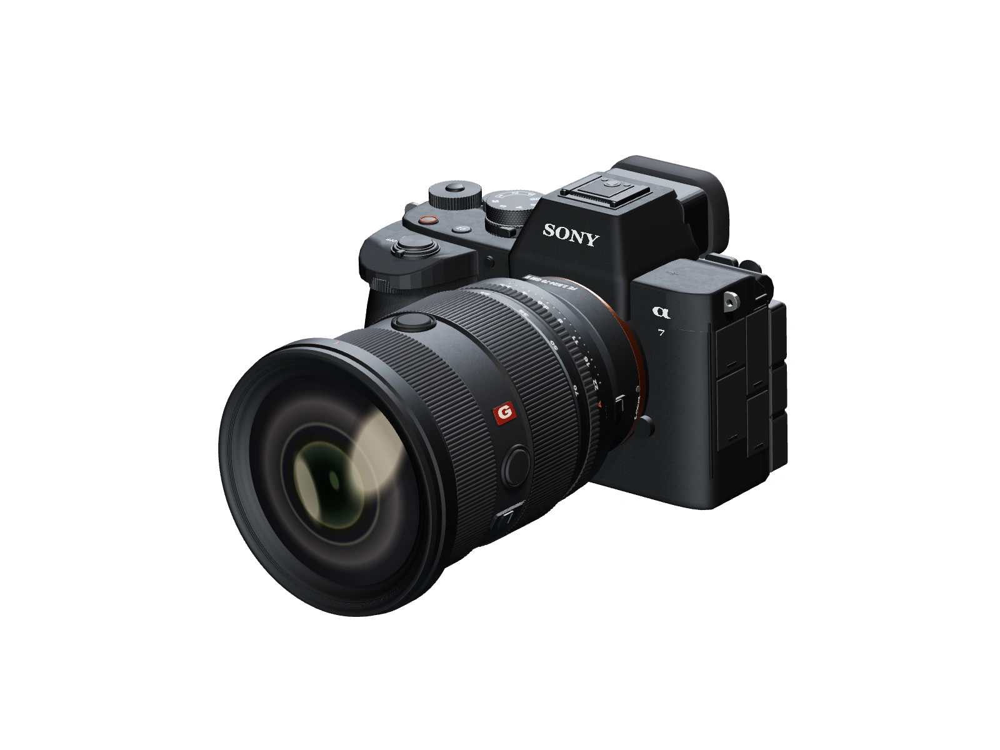

# α7 V 与 FE 24–70mm F2.8 GM II 外观评审

2026-11-24 · 开发版 v1 历史记录 · ILCE-7M5 + SEL2470GM2，24 mm 端。本目录的截图、数据与哈希对应第一版。后续评审记录见 [v2 材质](../model-v2/README.md) · [v3 卡仓](../model-v3/README.md)。

[五视角对照（下载源码后打开）](index.html) · [装机斜前方模型渲染](overview.webp) · [26 张原始参考图及下载地址](../assets/model-ref/sony/README.md)



## 尺寸

从最终 LOD0 GLB 的顶点和世界变换量得以下结果。原点为感光元件平面中心，镜头朝 glTF 的 +Z。数值单位为 mm。

| 测量对象 | GLB | 索尼规格 | 最大差值 |
|---|---|---|---|
| 机身主体宽 × 高 × 深，排除两只背带耳 | 130.42 × 96.38 × 82.52 | 130.3 × 96.4 × 82.4 | 0.12 |
| 镜头外径，取两个径向尺寸 | 87.80 / 87.85 | 87.8 | 0.05 |
| 卡口安装面至镜头前缘 | 119.90 | 119.9 | 0.00 |

两只背带耳都计入时，机身模型总宽为 140.80 mm。镜头模型另有伸入机身的卡爪段，包含该段的总长为 127.90 mm。索尼另列出握把至显示屏深度 72.3 mm。主体、卡爪和突出件分别报告，量取基准仍需随实机复核。[机身规格](https://www.sony.jp/ichigan/products/ILCE-7M5/spec.html) · [镜头规格](https://www.sony.jp/ichigan/products/SEL2470GM2/spec.html)

## 同角度叠图

照片先等比缩放到 800 px 宽作为量测坐标。模型以两倍分辨率渲染。背面以光轴和机身宽度配准，比例为 4.67 px/mm。机身与装机俯视的光轴横坐标均为 334 px，感光元件平面分别取纵坐标 253 和 746 px，投影横纵比例为 4.97 和 5.02 px/mm。镜头侧面按外圈直径取 4.18 px/mm。斜前方用同一张装机照片的 12 个标记拟合相机方位、俯仰、滚转与取景范围。[机身背面原图](https://alphauniverseglobal.media.zestyio.com/ILCE-7M5_rear-Large.jpg) · [机顶原图](https://alphauniverseglobal.media.zestyio.com/ILCE-7M5_top-Large.jpg) · [镜头侧面原图](https://alphauniverseglobal.media.zestyio.com/Alpha-Universe-Sony-24-70-GM-II-SEL2470GM2_B.jpg) · [装机俯视原图](https://alphauniverseglobal.media.zestyio.com/ILCE-7M5_SEL2470GM2_top-Large.jpg) · [装机斜前方原图](https://alphauniverseglobal.media.zestyio.com/ILCE-7M5_image_SEL2470GM2_right-Large.jpg)

用装机俯视照片另读一次中心点。下表以照片上的可见中心与模型转轴或按钮中心的二维距离换算。手工读点、镜头透视和原图分辨率均会影响结果。

| 部件 | 照片中心 (px) | 模型中心 (px) | 投影差距 (mm) |
|---|---|---|---|
| 快门 | 609, 627 | 610.0, 628.0 | 0.28 |
| C2 | 583, 713 | 583.0, 714.0 | 0.20 |
| 录像键 | 653, 713 | 653.0, 715.0 | 0.40 |
| 模式转盘 | 503, 759 | 504.0, 761.0 | 0.45 |
| 后拨盘 L | 586, 833 | 586.0, 833.0 | 0.00 |
| 后拨盘 R | 677, 818 | 678.0, 817.0 | 0.28 |
| 镜头顶部对焦保持键 | 333.5, 279 | 334.0, 283.7 | 0.93 |

在白底视图中，以亮度 220 作阈值、从画布外沿填充背景，计算实拍与模型外轮廓交集和并集的面积比。背面为 98.05%，机顶为 97.20%，镜头左侧为 98.80%，装机俯视为 97.02%。此指标只描述指定视角的外轮廓，内侧刻字和材质由并排图判读。

## 尚可辨认的差异

- **机身后背**。眼罩凹面的过渡、屏幕铰链节段和拇指胶皮的纹理仍有可见差异。对照图使用息屏画面，App 开机后由虚拟相机实时绘制读数。
- **机顶与镜头**。肩部的滚降曲面、快门基座、热靴盖细部和模式盘刻字仍需近照对齐。镜片镀膜、黑色漆面的高光及橡胶环反光受摄影棚布光影响。
- **机械动作**。拨盘档距、按键行程、24 至 70 mm 伸出量和开盖、翻屏的轴线与极限角需要实机测量。缩筒、对焦保持键的两处按钮和镜身开关已经拆成可单独驱动的部件。
- **终验**。36 个教学部件的 GLB 节点均已绑定。真实控件中心逐项达到 1 mm、全部刻字和材质逐项一致、机械动作正确及用户实机签字仍待验收。正式发布构建会运行严格检查。

## 可交付资产

| 资产 | 三角面 | 节点 | 体积 | SHA-256 |
|---|---:|---:|---:|---|
| v1 LOD0 | 97,138 | 292 | 4,417,540 B | `9293403c061a6fb2158a85139c61a77458fa71f93a20c8fb4dbe053e40515c13` |
| v1 LOD1 | 31,944 | 292 | 1,820,860 B | `0d5064b6140cd3f3c4b16b888db1ee6953652461660a4a0dc151ca05cf7a8bea` |

两级模型都采用 meshopt 和 5 张 KTX2，最大图集 2048 × 2048。开发检查覆盖节点、绑定、屏幕 UV、贴图与资源预算。另以 LOD0 网格从多个观察方向发射拾取射线，36/36 个教学部件均可从外部命中。模型源文件保留毫米坐标、独立绘制的刻字和材质构造。[模型源文件](../../../assets/camera/source/photo-study.mjs) · [导出脚本](../../../scripts/export-model.mjs) · [检查脚本](../../../scripts/check-model.mjs) · [环境光来源](../../../assets/camera/ATTRIBUTION.md)

重新导出及校图可从工程根目录执行以下命令。

```sh
node scripts/export-model.mjs
node scripts/check-model.mjs --placeholder
node scripts/build-camera3d.mjs --review
python3 -m http.server 8084 --bind 127.0.0.1 --directory build/model-review
```

在浏览器打开 `http://127.0.0.1:8084/camera3d/index.html`。资源加载完毕后，校图构建提供 `window.modelReview('back')` 等函数，返回对应 PNG 的 data URL。视角取值为 `back`、`top`、`lens`、`kit` 和 `overview`。[投影参数](../../../src/camera3d/review.ts)
