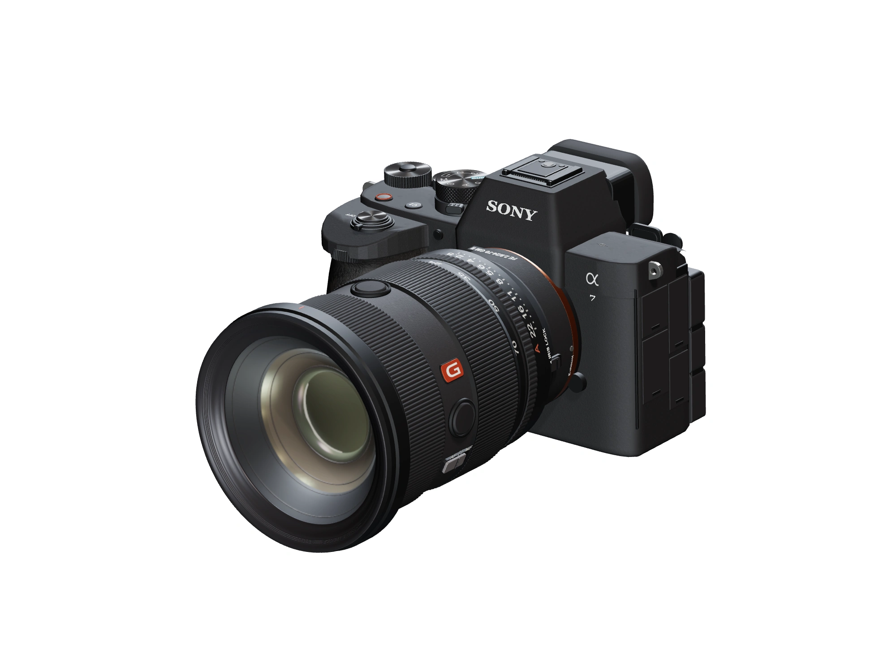

# α7 V 与 24–70 GM II 材质评审 v2

2026-11-24。模型依据 Sony ILCE-7M5 和 SEL2470GM2 的产品照、规格与帮助指南制作。这一版已进入 Android Preview。精确外观和机械行程仍待实机验收。

[局部放大与透明度叠图（下载源码后打开）](index.html) · [装机模型渲染](overview.webp) · [Android 预览截图](android.webp) · [26 张官方参考与原始出处](../assets/model-ref/sony/README.md)

## 材质与刻字

| 局部 | 模型中可观察的细节 | 与实拍对照 |
|---|---|---|
| 握柄和拇指胶皮 | 胶皮与砂纹漆分别使用底色、法线和粗糙度图。胶皮沟槽有断续，曲面握柄沿周长展开以保持颗粒尺寸。 | 颗粒疏密、沟槽形状和胶皮包边仍有差异。 |
| 模式盘 | 滚花由逐个菱形切面构成。盘面另有同心车纹、方向性反光、AUTO 色块和 1–3 数字边框。 | 转动可见切面明暗交替；刻字笔画、数字边框的圆角和盘面反光仍可辨别。 |
| G 标与开关 | G 字轮廓与弧边红牌独立绘制。对焦保持键有内外两圈，AF/MF 开关有凸起指示脊，另一侧的拨片沿镜筒切向滑动。 | 实物红牌亮面较强，对焦保持键的轮缘和开关槽还有深浅差异。 |
| 镜头橡胶环和刻度 | 三只操作环都有实际棱纹和中空内径。光圈、焦距的印刷位置按镜身侧照标定，IRIS LOCK 字样位于锥形开关前的环带。 | 数字字重、轮缘高光和细刻线的清晰度仍有差异。 |
| 镀膜和前镜组 | 曲面前镜片透光，后方有带独立曲率与间距的反射面、压圈和遮光筒。转动整机时，前后表面的视差与反光随视角变化。 | 实拍能看见更细的暖金、绿色和偏紫反射。模型中心亮边与几层反射的形状还有差距。 |

对照页的六个局部和五个完整视角来自同一份 LOD0 GLB。拍摄角度沿用第一版的配准参数，截图宽 2,000 px，每组左右使用相同裁切坐标与放大倍率。模型使用 App 的摄影棚灯光；索尼产品照的光位、光源尺寸与后期参数未知。可在页面中将右图调到 50% 检查几何边缘。参考图仅放在开发资料中。[配准方法](../model-v1/README.md) · [相机投影](../../../src/camera3d/review.ts) · [渲染灯光](../../../src/camera3d/main.ts)

## 尺寸与活动部件

| LOD0 量取位置 | 模型 | 索尼规格 |
|---|---:|---:|
| 机身主体宽 × 高 × 深，排除两侧背带耳 | 130.42 × 96.38 × 82.52 mm | 130.3 × 96.4 × 82.4 mm |
| 镜头横、纵外径 | 87.80、87.85 mm | 87.8 mm |
| 24 mm 端卡口安装面至镜头前缘 | 119.90 mm | 119.9 mm |

计入背带耳时，机身完整包围盒宽 140.80 mm。计入伸入机身的卡爪时，镜头完整包围盒长 127.90 mm。规格尺寸采用主体和安装面基准，全包围盒另列，便于拿真机核对突出件。[机身规格](https://www.sony.jp/ichigan/products/ILCE-7M5/spec.html) · [镜头规格](https://www.sony.jp/ichigan/products/SEL2470GM2/spec.html)

70 mm 端约 35 mm 的镜筒伸出量参照 CameraLabs 的实物评测。35 mm、50 mm 两档分别取约 12 mm 和 23 mm 作为预览估值。挡位刻线来自照片，拨盘实际档距、按键行程、翻屏与开盖极限角仍需实机量测。[镜头评测](https://www.cameralabs.com/sony-fe-24-70mm-f2-8-gm-ii-review/) · [实机验收项](../../spec/camera-model.md)

## 可复核的构建

| 文件 | 三角面 | 节点 | 文件大小 | SHA-256 |
|---|---:|---:|---:|---|
| [LOD0](../../../assets/camera/a7v.glb) | 145,850 | 324 | 6,197,176 B | `4dc9240c002497f0e4103715fdb8811454f34ec7e2cabdf79d555887b48e501c` |
| [LOD1](../../../assets/camera/a7v_lod1.glb) | 41,070 | 324 | 2,101,128 B | `e1921dfb2b347cfb44c3c75b7f48c97ab50f1db3c6e9e2a216f6a15ceb798231` |

两个模型都采用 meshopt 和 9 张 KTX2 纹理，最大图集为 2,048 × 2,048。开发检查覆盖控件、绑定、屏幕 UV 和资源预算。另从多个方向对 LOD0 实际网格发射射线，36 个教学部件均可从外部点中。

Android 模拟器已安装独立 Preview 包，验证了离线镜片显示、全景和正面视图、拖动旋转与 24、35、50、70 mm 变焦。在 70 mm 端直接点击镜身对焦保持按钮，App 打开了对应部件详情。包内两份 GLB、环境光及渲染页面均已逐字节核对。两份 GLB 仍标记为开发资产，严格 Release 检查还会报告含背带耳、卡爪的完整包围盒与标称尺寸的差异。骁龙 7 系手机性能和实机外观签字待完成。[模拟器性能记录](../../spike-perf.md)

[下载 Android Preview APK](https://github.com/MathildaStacy/A7M5Tutorial/releases/download/v0.1.0-preview.1/ShutterAcademy-0.1.0-preview.1-arm64-v8a.apk) · [几何与字标源文件](../../../assets/camera/source/photo-study.mjs) · [材质图生成](../../../assets/camera/source/finishes.mjs) · [导出脚本](../../../scripts/export-model.mjs) · [贴图及光照来源](../../../assets/camera/ATTRIBUTION.md)
