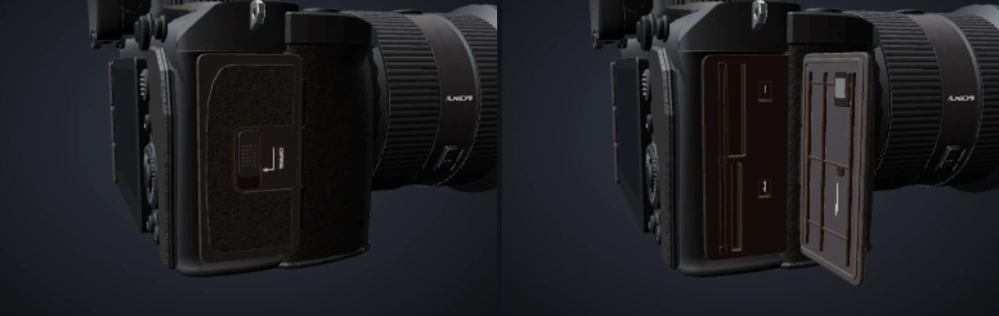

# α7 V 存储卡仓与开箱互动

本页记录 2026-11-25 的 Android 预览版 `v0.2.0-preview.1`。打开「学习 → L0 开箱 → 演示」第 2 步，可以在电源关闭时点开仓盖，辨认上槽 1 和下槽 2，再将仓盖合上。两幅图均取自安装包在 Android 模拟器中的同一视角，左图为关盖，右图为开盖。[完整课程截图](opening-lesson.webp)

## 对照实物

| 位置 | 模型细节与依据 |
|---|---|
| 仓盖外侧 | 根据右侧产品照描出绕开锁扣的 C 形皮纹包覆。拨片下方留出锁槽，表面有方形凸点，旁边刻有竖排 OPEN 和转折方向箭头。[索尼右侧实拍](https://alphauniverseglobal.media.zestyio.com/ILCE-7M5_rightside-Large.jpg) |
| 仓内 | 上方的 1 号槽兼容 CFexpress Type A 和 SD，下方的 2 号槽使用 SD。两个槽口各有独立开口、底面和导轨。盖板内侧加入密封圈、加强筋、螺钉和推入方向标记。[索尼开盖实拍](https://alphauniverseglobal.media.zestyio.com/ILCE-7M5_cards-Large.jpg) |
| 开合 | 仓盖绕靠镜头一侧的铰链转动，仓体与导轨固定在机身。相机页选中「存储卡仓」后可「近看部件」或开合仓盖。预览取 96° 为开盖角，锁扣行程、铰链间隙和极限角仍待实机测量。[索尼帮助指南示意图](https://helpguide.sony.net/ilc/2540/v1/zh-cn/contents/image/c_ilc2540_partname_08.png) |

近看时增加一盏侧上方的补光，便于在黑色仓盖上辨认皮纹、文字与插槽轮廓。握柄胶皮颗粒和镜片镀膜的反射仍需在相同光位下与实机核对。[上一版五视角与材质评审](../model-v2/README.md) · [实机验收标准](../../spec/camera-model.md)

## 随 APK 分发的模型

| 模型 | 三角面 | 节点 | 字节数 | SHA-256 |
|---|---:|---:|---:|---|
| [整机 LOD0](https://github.com/MathildaStacy/A7M5Tutorial/blob/v0.2.0-preview.1/assets/camera/a7v.glb) | 161,287 | 384 | 7,090,680 | `1dea93070db8eb88dbcc2d1eb85cf608ac7db8232ea1520e9646fe4682729dd9` |
| [课程与复盘 LOD1](https://github.com/MathildaStacy/A7M5Tutorial/blob/v0.2.0-preview.1/assets/camera/a7v_lod1.glb) | 45,111 | 384 | 2,378,048 | `a7147f4f733e17629651f7ed0858d29944f35a0a743e0111d1991a91c63d2c3e` |

两份 GLB 均包含 36 个教学部件和 9 张 KTX2 贴图。量取 LOD0 顶点，排除背带耳后的机身宽、高、深分别为 130.48、96.38、82.52 mm，索尼标称 130.3、96.4、82.4 mm。24 mm 端镜头外径为 87.80–87.85 mm，卡口安装面至前缘为 119.90 mm。这些整体尺寸可以复核，逐个按键的位置、表面光泽和机构手感仍需用实机验收。[机身规格](https://www.sony.jp/ichigan/products/ILCE-7M5/spec.html) · [镜头规格](https://www.sony.jp/ichigan/products/SEL2470GM2/spec.html) · [模型源文件](../../../assets/camera/source/photo-study.mjs)
